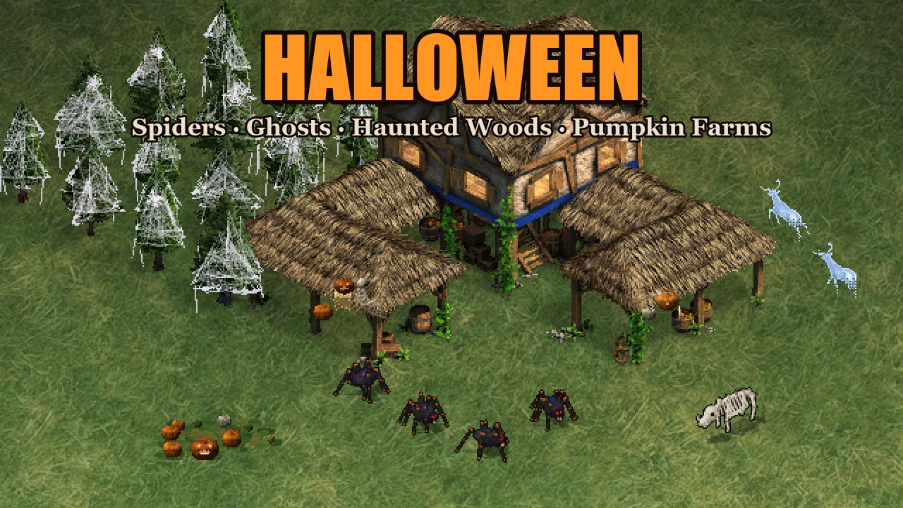
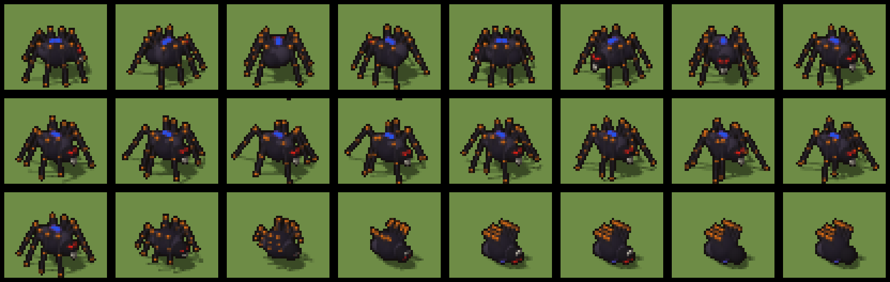
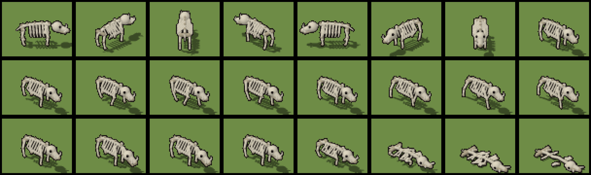
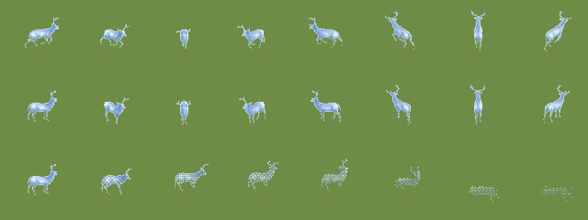
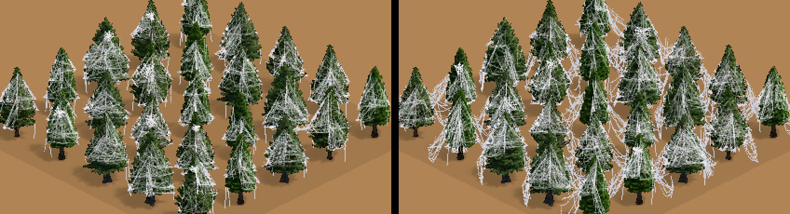
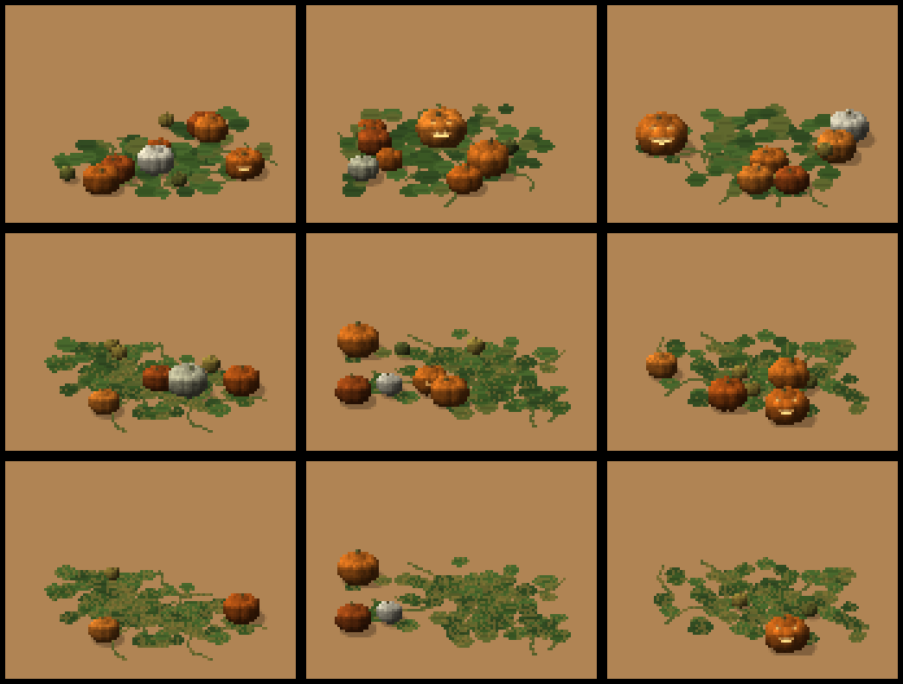
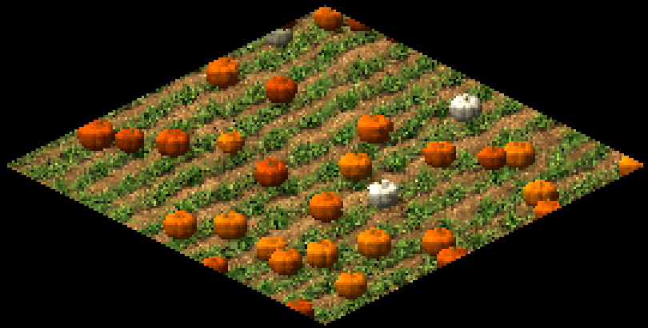
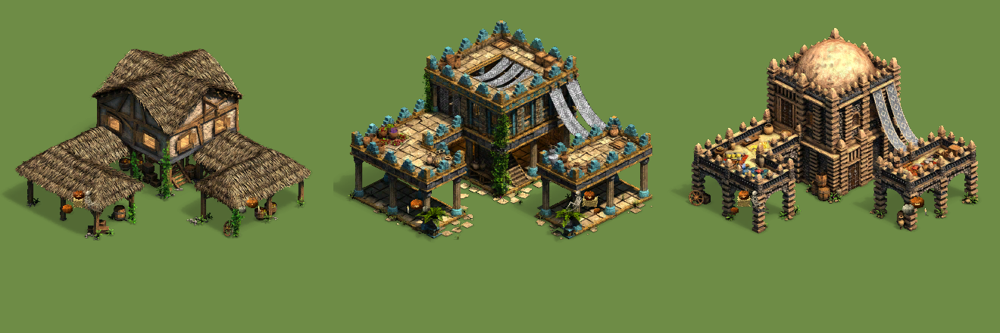
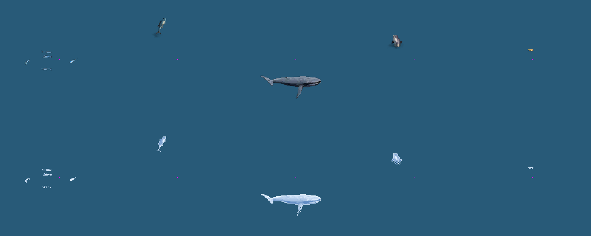

# Halloween for Age of Empires II: Definitive Edition

A graphics mod that gives every map a Halloween makeover, plus the small Python toolkit that
built it. Every sprite is generated by code from scratch or from the game's own art. No
third-party mod art is included.



## At a glance

| | |
|---|---|
| **Released** | October 2026, publicly on the official [Age of Empires mod site](https://www.ageofempires.com/mods/details/562122) |
| **Author** | Saeed Sabzeh |
| **Scale** | 422 sprite files and 4 ground textures (~200 MB), generated by one build script |
| **Coverage** | Every civilization and every map: all 17 herd animal types, 26 huntable types, 47 tree types, 4 forage bush types, 10 fish types, farms, fish traps, pastures, and 105 Town Center graphics across all 20 architecture sets and ages. Checked against all 180 random-map scripts, including the ranked pool. |
| **Works in** | Single player, multiplayer and ranked (graphics only, client-side) |
| **Stack** | Python 3, NumPy, Pillow. No game-engine or third-party modding tools. |
| **Key techniques** | Binary format reverse engineering, block texture compression (BC1/DXT1, BC4), DDS mip chains, software rendering (z-buffer and painter's algorithm), procedural generation, image warping, ordered dithering |

## What changes

| In game | Becomes |
|---|---|
| Herd animals (sheep, goats, cows, pigs, llamas, buffalo, turkeys, geese, chickens…) | **Spider sheep**: black wool, eight legs, red eyes, a player-coloured mark on the back |
| Wild game (deer, hares, elk, gazelles, ostriches, zebras, elephants…) | **Ghosts of themselves**: the original animation, pale, glowing and see-through |
| Boars, javelinas and bushpigs | **Skeleton boars** |
| Forests | **Haunted woods**: small pines draped in layered cobwebs, strung tree to tree in jungles |
| Forage bushes (berry, fruit, papaya, pineapple) | **Pumpkin patches** that empty and wilt as they're gathered |
| Farms | **Pumpkin fields** that grow from buds to ripe pumpkins |
| Fish (all ten kinds) | **Ghost fish** |
| Fish traps and pastures | Cobwebs, jack-o'-lanterns, skulls on the fence posts |
| Town Centers (every culture, every age) | A harvest display at the two outer corners: a hay bale, varied jack-o'-lanterns, a candle and a slumped skeleton. The front stays clear, so carcasses are easy to spot. |

It only changes graphics, so it works in multiplayer and ranked, and other players don't need it.

| | |
|---|---|
|  |  |
|  |  |
|  |  |
|  |  |

## Install

Subscribe on the [mod page](https://www.ageofempires.com/mods/details/562122), or search for
"Halloween" in the game's mod browser (**Mods → Browse Mods**). You can also build it yourself (below).
Don't combine it with other mods that replace the same animals, trees or bushes.

## Build it yourself

Needs Python 3.10+ and the game installed.

```bash
pip install -r requirements.txt
```

```bash
python tools/build_halloween.py
```

The mod is written straight into your local mods folder. If the game isn't in the default Steam
location, set `AOE2_DIR` to the install folder. To write the mod somewhere else, set `AOE2_MODS`.
A full build takes about half an hour, mostly rendering the spider animations.

There's also a second, smaller mod in the repo: `tools/build_pizza.py` turns sheep into pizzas and
berry bushes into ketchup bottles.

## The toolkit

| File | What it does |
|---|---|
| `tools/sld.py` | Reads and writes DE `.sld` sprites: main (BC1), shadow (BC4), damage, player colour and the silhouette layer |
| `tools/outline.py` | Encodes and decodes the per-frame silhouette layer (see below) |
| `tools/smx.py` | Reads older palette-based `.smx` sprites |
| `tools/render3d.py`, `tools/poly3d.py` | Tiny renderers (spheres/capsules and flat faces) using the game's camera and sun direction |
| `tools/ghost.py`, `tools/webs.py`, `tools/harvest.py`, `tools/farm.py` | The effects: ghosts, cobwebs, harvest props, farm textures |
| `tools/modkit.py` | Places sprites on the game's canvas and writes mod folders |

### Notes on the `.sld` format

Most of it follows the [openage documentation](https://github.com/SFTtech/openage/blob/master/doc/media/sld-files.md).
Real files differ from it in a few places:

- **Bit order.** Layer and frame flag bits are numbered from the lowest bit: main = `0x01`,
  shadow = `0x02`, silhouette = `0x04`, damage = `0x08`, player colour = `0x10`.
- **Header size.** The header's fourth `uint16` is the header size. It's 16 in most files and 14
  in some, such as the hunting chickens and the guanaco.
- **Copied blocks.** Blocks copied from the previous frame (flag `0x80`) are matched by canvas
  position, because the layer box can move between frames.
- **Silhouette layer (`0x04`).** Undocumented. It's one 16-bit mask per 4×4 block of the main
  layer, with bit *i* = pixel *i* row by row. After a table of row offsets, each block row is:
  - an optional leading skip of empty blocks;
  - then `0x80 | n` followed by *n* masks, or a plain byte that skips *n* fully solid blocks;
  - a skip at the end of a row means empty;
  - every row adds up to the full width.

  The game uses this layer for the outlines of units hidden behind buildings. Leaving it out
  causes garbled outlines.

## How it works

The build reads the game's own sprite and texture files, transforms or replaces every frame, and
writes them back in the game's formats.

- **Sprite I/O.** `sld.py` decodes and encodes the DE sprite format: per-frame layers, 4×4 block
  command streams, BC1 colour blocks, BC4 shadow and player-colour blocks, and blocks reused from the
  previous frame. The encoders are vectorised with NumPy: principal-axis endpoint fitting for BC1,
  with a 3-colour mode for transparent blocks. That's fast enough to re-encode the ~150,000 frames
  of a full build.
- **3D renderers.** `render3d.py` is a z-buffered renderer for spheres and capsules (used for spiders,
  skeletons and pumpkins). `poly3d.py` is a painter's-algorithm renderer for flat faces (hay bales,
  boxes). Both use the game's 2:1 isometric camera (30° elevation), light from the upper left, and
  produce player-colour masks and ground shadows. Creatures are animated by code (gait cycles, lunges,
  collapses) for all 16 directions, matching each original animation's exact frame count.
- **Ghosts from the game's own art.** `ghost.py` recolours the original animal frames along their
  luminance, adds a soft rim glow, and makes them see-through with a canvas-aligned 4×4 Bayer dither,
  since the format only has on/off alpha. They fade towards the legs and leave a faint shadow on the
  ground under the hovering sprite.
- **Procedural cobwebs.** `webs.py` drapes layered gauze (many faint strands inside polygons that
  build up where they overlap), tatters and orb webs over each tree, plus veils strung over to
  neighbouring trees in dense jungle.
- **Harvest props.** `harvest.py` generates every pumpkin individually: size, rib count, colour,
  stem and one of several carved faces with an inner glow. It also makes hay bales with straw texture,
  candles and vines. `tc_pumpkins.py` places them on every Town Center without growing the sprite's
  box, so the original masks stay valid.
- **Farm textures.** `farm.py` paints pumpkins onto the farm ground textures (DXT1 `.dds` with a full
  mip chain down to 1×1). Ground textures are laid on the map as diamonds, so each pumpkin is
  rendered as a lit sprite for the game camera and then warped by the inverse of the ground mapping.
  On screen it comes out round and solid instead of flat.
- **Mod packaging.** `modkit.py` places sprites on the game's canvas on its 4-pixel block grid,
  keeps every file's original frame count, and writes the mod folder, `info.json` and thumbnail.

## Problems solved along the way

- **Undocumented silhouette layer.** Generated sprites without it made the game draw garbled outlines
  for units hidden behind buildings. I decoded its structure by comparing it against the visible
  pixels of hundreds of frames (97–100% match), then wrote an encoder whose output decodes back exactly.
- **Spec mismatches.** The public format notes number flag bits from the opposite end, and some files
  use a 14-byte header instead of 16. Both were found from crashes and fixed in the reader.
- **Flat-looking farm pumpkins.** The first version painted pumpkins from directly above, so they
  showed up as smears. I put a test texture with arrows and circles in the game, read the real mapping
  from one screenshot (u → screen upper right, v → lower right, 0.234 screen px per texture px), and
  rebuilt the warp to match.
- **Mod conflicts.** Grid and tree mods replace the same files. Found by inspecting other mods'
  folders and resolved with load priority.
- **Readability in play.** Based on testing feedback: carcasses blended into Town Center decorations,
  so the front was cleared; ghosts were too faint, so they got shadows and stay visible while
  gathered; forests were whitewashed, so web density was tuned per forest type.
- **No third-party art.** Trees were rebuilt from the base game's pines (scaled, with a hand-made tile
  grid shadow) so the published mod contains only original work and the game's own assets.

## How it was tested

Every change was previewed in a contact sheet (sprites read back from the written files and composited
the way the game draws them), then checked in real skirmish games from screenshots. Coverage was
checked by comparing every food-source, tree and Town Center graphic in the game against the mod
folder, and by scanning all random-map scripts for the objects and forest terrains they place.

## Known limitations

- **UHD graphics.** Players with the Enhanced Graphics Pack load `_x2` sprites, which aren't built yet.
- **Return of Rome.** It's a separate game mode with its own graphics and isn't covered.
- **Load order.** The mod needs a higher priority than other mods that replace the same files, such
  as grid mods (which replace the farm textures).

## Credits

- Format research: the [openage](https://github.com/SFTtech/openage) project.
- Age of Empires II © Microsoft Corporation. This mod was created under Microsoft's
  "[Game Content Usage Rules](https://www.xbox.com/en-US/developers/rules)" using assets from
  Age of Empires II: Definitive Edition, and it is not endorsed by or affiliated with Microsoft.

## License

The code in this repository is released under the [MIT License](LICENSE). The game assets it
reads, and the sprites it builds from them, remain © Microsoft and are covered by the Game
Content Usage Rules above, not by the MIT License.
